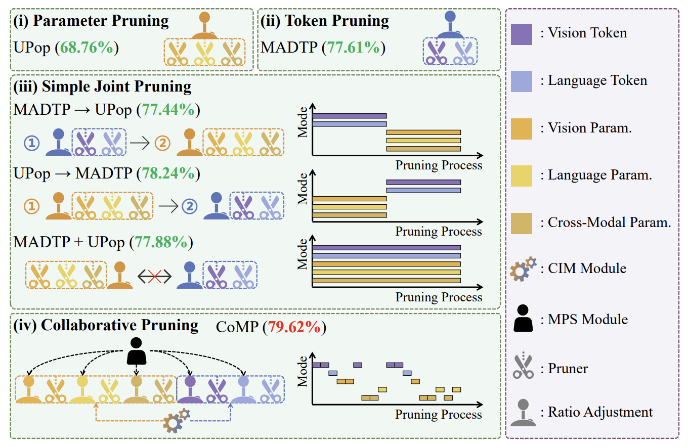

# Collaborative Multi-Mode Pruning for Vision-Language Models

Zimeng Wu<sup>1,2</sup>, Yunhong Wang<sup>1,2</sup>, Donghao Wang<sup>1,2</sup>, Jiaxin Chen<sup>1,2,†</sup>

<sup>1</sup> School of Computer Science and Engineering, Beihang University<br>
<sup>2</sup> State Key Laboratory of Virtual Reality Technology and Systems, Beihang University

📝 **CVPR 2026** | [Paper](https://arxiv.org/abs/2604.02956)

## Introduction

We propose **CoMP (Collaborative Multi-Mode Pruning)**, a framework for jointly pruning parameters and tokens in the vision, language, and cross-modal components of VLMs. The **Collaborative Importance Metric (CIM)** accounts for interactions between parameter and token importance, while the **Multi-Mode Pruning Strategy (MPS)** adaptively selects pruning modes using pruning costs, historical information, and random exploration.



## Codebase Overview

- [`comp_compress_blip_nlvr.py`](comp_compress_blip_nlvr.py): Pruning search, fine-tuning, and evaluation entry point.
- [`scripts/comp_compress_blip_nlvr_08.sh`](scripts/comp_compress_blip_nlvr_08.sh): Example script targeting an 80% FLOPs reduction.
- [`configs/nlvr.yaml`](configs/nlvr.yaml): Dataset paths, BLIP configuration, batch sizes, and optimizer settings.
- [`models/`](models/): BLIP, vision/text encoders, importance metrics, and structural compression.
- [`data/`](data/), [`transform/`](transform/), and [`utils.py`](utils.py): Dataset loading, augmentation, and training utilities.

## Setup and Usage

### Requirements and Installation

We recommend the requirements as follows.

- python==3.8.13
- torch==1.11.0
- transformers==4.15.0

To get started quickly, you can use the following script.

```bash
git clone https://github.com/Wuzimeng/CoMP.git
cd CoMP
conda env create -f environment.yml
conda activate comp
```

### Model and Dataset Preparation

Download the [BLIP NLVR2 checkpoint](https://storage.googleapis.com/sfr-vision-language-research/BLIP/models/model_base_nlvr.pth) released by [BLIP](https://github.com/salesforce/BLIP), and the tokenizer files (`vocab.txt`, `tokenizer_config.json`, and `config.json`) from [bert-base-uncased](https://huggingface.co/google-bert/bert-base-uncased/tree/main). Place them as follows; BERT model weights are not required:

```text
CoMP/
├── pretrained/
│   ├── blip/
│   │   └── model_base_nlvr.pth
│   └── bert-base-uncased/
│       ├── vocab.txt
│       ├── tokenizer_config.json
│       └── config.json
├── configs/
└── scripts/
```

The tokenizer is loaded from the fixed path `./pretrained/bert-base-uncased/`. Run all commands from the repository root. A custom BLIP checkpoint path can be supplied with `--pretrained`.

Download the [NLVR2 images](https://lil.nlp.cornell.edu/nlvr/) and update these paths in `configs/nlvr.yaml`:

```yaml
image_root: '/absolute/path/to/NLVR2/'
ann_root: '/absolute/path/to/NLVR2/annotations/'
```

The loader downloads `nlvr_train.json`, `nlvr_dev.json`, and `nlvr_test.json` to `ann_root` when absent. Each image path in these annotations is resolved relative to `image_root`; preserve the corresponding image subdirectories. For offline use, download the three annotation files from the URLs in [`data/nlvr_dataset.py`](data/nlvr_dataset.py) beforehand. All three splits are loaded, including during checkpoint evaluation.

### Quick Start with CoMP

```bash
bash scripts/comp_compress_blip_nlvr_08.sh
```

The script runs a two-epoch warm-up, pruning search, and fine-tuning, reporting validation/test accuracy and estimated GFLOPs throughout.

**Explanation on Configs:**

- Full pipeline: warm-up -> pruning search -> fine-tuning
  - `--config ./configs/nlvr.yaml`: YAML configuration file
  - `--pretrained pretrained/blip/model_base_nlvr.pth`: Initial BLIP checkpoint: local path or URL
  - `--p 0.8`: Target FLOPs reduction ratio
  - `--epoch 30`: Shared search/fine-tuning epoch budget
  - `--output_dir output/comp_compress_blip_nlvr_08`: Output directory

- Reuse intermediate results
  - `--firstfit <firstfit_ckpt.pth>`: Reuse a warm-up checkpoint and start pruning search
  - `--searched <search_final_ckpt.pth>`: Start fine-tuning from a completed search

- Evaluate a compressed checkpoint: supply these three options together
  - `--searched <search_final_ckpt.pth>`: Reconstruct the pruned architecture from its masks
  - `--finetuned <finetune_best_ckpt.pth>`: Load the structurally compressed weights; skip fine-tuning
  - `--evaluate`: Evaluation mode; use with both checkpoints above

## Citation

If you find this repository helpful, please consider citing our paper:

```bibtex
@InProceedings{Wu_CoMP_2026_CVPR,
    author    = {Wu, Zimeng and Wang, Yunhong and Wang, Donghao and Chen, Jiaxin},
    title     = {Collaborative Multi-Mode Pruning for Vision-Language Models},
    booktitle = {Proceedings of the IEEE/CVF Conference on Computer Vision and Pattern Recognition (CVPR)},
    month     = {June},
    year      = {2026},
    pages     = {39561-39571}
}
```

## Acknowledgements

This implementation builds upon the following projects. We sincerely thank the original authors for their outstanding contributions!

- [BLIP](https://github.com/salesforce/BLIP) for the model implementation and pretrained checkpoints.
- [UPop](https://github.com/sdc17/UPop) for the unified and progressive pruning implementation.
- [MADTP](https://github.com/double125/MADTP) for the multimodal alignment and dynamic token pruning implementation.
- PyTorch and Transformers for the foundational frameworks.